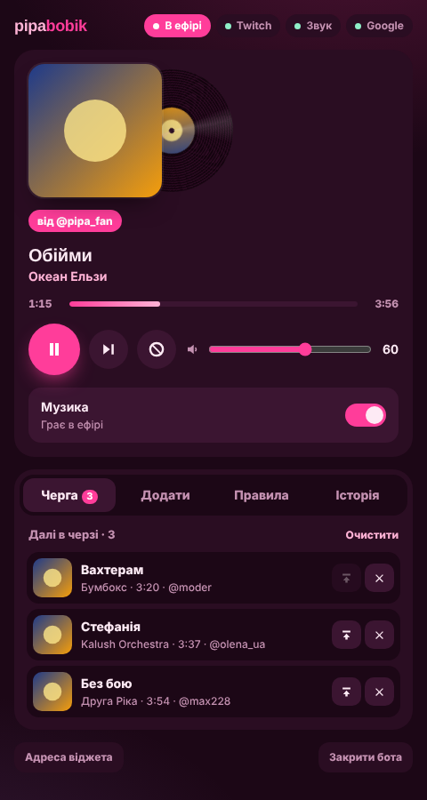

# 🎀 pipabobik

Музичний бот для Twitch на **YouTube Music**, без Spotify.
Глядач пише `!трек назва пісні`, бот знаходить трек у YouTube Music і вмикає його. Звук іде в трансляцію через OBS, а рожевий віджет із платівкою показує, що зараз грає.

<p align="center"></p>
<p align="center"></p>

- 🔎 **Пошук за назвою** в розділі «Пісні» YouTube Music: без кліпів з інтро і без «10 годин…». Посилання YouTube теж працюють.
- 🔐 **Вхід у ваш Google-акаунт**: доступні треки 18+, менше блокувань, фонова музика з ваших вподобаних.
- 🛡 **Захист від тролів**: ліміт тривалості, ліміт треків на людину, кулдаун, бан-слова, бан треку.
- 🇺🇦 **Фільтр російської музики**: російські виконавці й пісні російською автоматично йдуть у бан.
- 💾 **Черга не губиться** між стрімами.
- 🎛 **Окремий застосунок-панель**: пауза, пропуск, гучність, черга, пошук і додавання треків, правила, бан-лист. Усе без жодної команди в чаті.
- 🚀 **Автозапуск разом з OBS**: музика грає лише під час трансляції.
- 🏠 **Працює на вашому ПК**: сервер не потрібен, чужі хмарні ліміти не заважають.

Чому бот зроблено саме так і які проблеми інших ботів він закриває, див. у [docs/ANALIZ.md](docs/ANALIZ.md).

---

## Команди

| Команда | Хто | Що робить |
|---|---|---|
| `!трек назва` | усі | замовити трек (можна й посилання YouTube / YT Music) |
| `!шоце` | усі | що зараз грає, хто замовив, посилання |
| `!черга` | усі | наступні треки |
| `!нетой` | усі | прибрати свій останній трек з черги |
| `!музика` | усі | підказка по командах |
| `!хуйня` | модератори, стрімер | пропустити трек |
| `!пауза` | модератори, стрімер | пауза / продовжити |
| `!грай` | модератори, стрімер | увімкнути музику (якщо вимкнена) |
| `!гучність 0-100` | модератори, стрімер | гучність |
| `!бантрек` | модератори, стрімер | заборонити поточний трек назавжди й пропустити |

Назви команд можна змінити в `config.toml`. Англійські синоніми `!sr`, `!skip`, `!song` теж працюють.

---

## Встановлення (Windows, ~10 хвилин)

### 1. Завантажте бота
На GitHub натисніть **Code → Download ZIP** і розпакуйте архів, наприклад у `C:\pipabobik`.
Шлях без кирилиці й пробілів допоможе уникнути проблем.

### 2. Створіть акаунт для бота (рекомендовано)
Щоб повідомлення в чаті йшли від імені **pipabobik**, а не від вашого:
1. Зареєструйте на Twitch новий акаунт (наприклад `pipabobik` або схожий вільний нік).
2. У своєму чаті напишіть `/mod нік_бота`. Модератора Twitch не так жорстко обмежує за кількістю повідомлень.

> Можна обійтися і без цього: тоді бот писатиме від вашого імені.

### 3. Зареєструйте застосунок Twitch
1. Відкрийте https://dev.twitch.tv/console/apps і увійдіть **своїм** акаунтом (знадобиться двофакторна автентифікація).
2. Натисніть **Register Your Application**:
   - **Name**: будь-яка, наприклад `pipabobik-вашнік`
   - **OAuth Redirect URLs**: `http://localhost:17777/auth/callback`
   - **Category**: Chat Bot
   - **Client Type**: Confidential
3. Відкрийте **Manage** → скопіюйте **Client ID** → натисніть **New Secret** і скопіюйте **Client Secret**.

### 4. Увійдіть у Google у Firefox
Бот бере логін Google з **Firefox**. Chrome з 2024 року не віддає дані входу іншим програмам.
1. Встановіть Firefox, якщо його немає.
2. Увійдіть на https://music.youtube.com своїм акаунтом Google.
3. Firefox можна закрити: логін зберігається.

> 💡 Для бота краще використати **окремий** Google-акаунт. Автоматичний доступ до YouTube теоретично може не сподобатися Google.
> Не хочете логінитись? У майстрі просто натисніть Enter. Пошук і відтворення працюватимуть, але без треків 18+ і без ваших вподобаних.

### 5. Запустіть `install.bat`
Двічі клацніть **install.bat**. Він сам:
- встановить Python (якщо його немає; тоді запустіть install.bat ще раз), **mpv** (програвач) і **Deno** (без нього YouTube тепер не віддає звук);
- поставить бібліотеки;
- запустить **майстер налаштування**. Вставте туди нік каналу, Client ID і Client Secret.

Наприкінці відкриється сторінка Twitch. **Увійдіть акаунтом бота** (зручно відкрити її в приватному вікні) і натисніть «Authorize». З'явиться напис «✅ Готово!».

### 6. Перевірте
Запустіть **check.bat**. Ви побачите список перевірок, а бот зіграє 5 секунд пісні. Скрізь має стояти ✅.

---

## Підключення до OBS

### Автозапуск бота
1. OBS → **Інструменти → Скрипти** → **«+»** → оберіть `obs\pipabobik.lua`.
2. **Папка бота** → `C:\pipabobik` (там, де лежить `bot.py`).
3. **Коли запускати**:
   - *Разом з OBS*: бот готовий одразу, музика вмикається з початком трансляції;
   - *Разом з трансляцією*: бот стартує лише коли ви натискаєте «Почати трансляцію».

Після кінця трансляції музика стає на паузу, а черга зберігається. Коли ви закриваєте OBS, бот закривається теж.

**Як зупинити бота вручну:**
- закрийте вікно pipabobik або натисніть **«Вимкнути pipabobik»** у ньому;
- кнопкою **«Зупинити бота»** у налаштуваннях скрипта (Інструменти → Скрипти → pipabobik.lua);
- якщо бот запущено через `start.bat`, закрийте це вікно;
- в крайньому разі: Диспетчер завдань → Подробиці → `pythonw.exe` → Завершити завдання. Програвач закриється разом з ботом.

Бот закривається разом з OBS незалежно від того, як його запустили (скриптом, ярликом чи `start.bat`), якщо OBS був відкритий, поки бот працював.

### Звук
1. Запустіть бота й замовте будь-який трек у чаті (`!трек ...`), щоб mpv заграв. У панелі задач з'явиться згорнуте вікно **pipabobik**: так і має бути, не закривайте його.
2. OBS → **Джерела → «+» → Захоплення звуку програми** (Application Audio Capture).
3. **Вікно**: оберіть **[mpv.exe]: pipabobik**.
4. **Пріоритет збігу вікна**: оберіть варіант, де йдеться про **виконуваний файл** (exe). Тоді OBS сам підхоплює кожен новий трек.
5. Гучність регулюйте тут або командою `!гучність`.

> Якщо джерела «Захоплення звуку програми» немає (старий OBS), у `config.toml` вкажіть `audio_device` (віртуальний кабель) або захоплюйте весь звук робочого столу.

### Віджет «зараз грає»
1. **Джерела → «+» → Браузер**.
2. URL: `http://localhost:17777/widget`
3. Ширина **680**, висота **220**.

Параметри адреси (додайте після `?`, кілька параметрів з'єднуйте через `&`):

| Параметр | Що робить |
|---|---|
| `idle=hint` | коли тиша, показувати «Замов трек!» замість приховування |
| `scale=1.3` | збільшити віджет |
| `demo=1` | показати демо-трек, щоб розставити віджет без запущеного бота |

Наприклад: `http://localhost:17777/widget?idle=hint&scale=1.2`

### Панель керування (окремий застосунок)
Окреме вікно pipabobik, щоб керувати музикою без команд у чаті:
- **зараз грає**: обкладинка, прогрес, пауза, пропуск, бан треку, гучність, перемикач «Музика»;
- **Черга**: поставити трек наступним, прибрати, очистити все;
- **Додати**: знайти пісню й поставити в чергу, наступною або одразу;
- **Правила**: хто замовляє, ліміти, фільтри, фоновий плейлист, заборонені слова. Зміни діють одразу й зберігаються в `config.toml`;
- **Історія**: що вже грало (кнопка «Ще раз»), а також бан-лист із кнопкою «Розбанити».

Як відкрити:
- **Разом з OBS**: у налаштуваннях скрипта `pipabobik.lua` поставте галочку **«Відкривати панель керування разом з OBS»** (стоїть за замовчуванням);
- **ярликом «pipabobik»** на робочому столі або в меню «Пуск». Ярлик створюють `install.bat` і `update.bat`, а також окремо `panel_shortcut.bat`.

**Закріпити на панелі задач:** коли pipabobik відкритий, клацніть правою кнопкою по його рожевому значку на панелі задач → **«Закріпити на панелі завдань»**.

Як поводиться застосунок:
- **закрили вікно** → pipabobik вимикається повністю: музика зупиняється, поточний трек повертається на початок черги, черга зберігається. Перед закриттям він перепитає;
- **закрили OBS** → музика зупиняється, бот і вікно закриваються самі, черга зберігається;
- **повторний клік по ярлику** не відкриває другу копію, а показує вже відкрите вікно;
- якщо бот ще не працює, застосунок запустить його сам: з OBS — у режимі трансляції, без OBS — на паузі (музику вмикає перемикач «Музика»).

> Вікно працює на вбудованому WebView2 (пакет `pywebview`, ставиться через `install.bat` / `update.bat`). Якщо він не встановився, панель відкривається в Microsoft Edge у режимі застосунку: працює так само, тільки значок на панелі задач буде від Edge.

> Стара панель для дока OBS теж працює: `http://localhost:17777/panel?key=…` (адреса з ключем є на сторінці `http://localhost:17777`).

### ⚠ Авторські права (DMCA)
За чужу музику на Twitch можуть заглушити записи трансляцій або дати страйк. Щоб музика була **в ефірі, але не в записі (VOD)**:
1. OBS → **Налаштування → Вивід → Режим: Розширений → Трансляція** → увімкніть **Twitch VOD Track** і оберіть, наприклад, доріжку 2.
2. **Розширені властивості аудіо** (⚙ у мікшері): у джерела `mpv.exe` **зніміть** галочку з доріжки 2.

Так глядачі наживо музику чують, а в записі її немає. Для повністю безпечного варіанту поставте фоновим плейлистом музику без авторських прав і обмежте замовлення (`who_can_request = "mods"`).

---

## Фільтр російської музики

Увімкнений за замовчуванням: панель → «Правила» → «Блокувати російську музику», або `block_russian` у `config.toml`. Фільтр перевіряє:
1. **мову назви**: літери ы, э, ъ, ё і типово російські слова. Якщо в назві є українські і, ї, є, ґ, вона вважається українською;
2. **список російських виконавців** (кирилицею та латиницею). Свої імена можна дописати в `russian_artists`;
3. **країну виконавця** у відкритій музичній базі MusicBrainz. Відповідь запам'ятовується, тож кожного виконавця бот перевіряє лише раз.

Якщо глядач замовив російський трек, бот відповідає, що такого тут не грають, і додає трек у бан-лист. Іншу пісню замість нього бот не підсовує. Російські треки з фонового плейлиста просто пропускаються.

Фільтр не ідеальний: маловідомий виконавець із назвою транслітом може проскочити, а зрідка фільтр може помилитися. Тоді у вкладці «Історія» натисніть **«Розбанити»**: трек буде дозволено, і фільтр більше його не чіпатиме.

## Навантаження на комп'ютер

Бот зроблено якомога легшим:
- програвач mpv запускається без конфігів, скриптів і екранних елементів, а вирівнювання гучності працює легшим фільтром `dynaudnorm`;
- yt-dlp не створюється заново для кожного треку: логін Google читається один раз, розшифровка плеєра YouTube кешується;
- у віджеті обертання платівки рахує відеокарта, прогрес оновлюється раз на секунду, а коли нічого не грає, анімації стоять;
- бот майже нічого не робить, поки в чаті немає команд.

Орієнтовно це 150–250 МБ пам'яті й кілька відсотків процесора. Щоб зекономити ще трохи: у властивостях віджета в OBS поставте **FPS 30** і **«Вимикати джерело, коли воно не видиме»**, а якщо вирівнювання гучності не потрібне, вимкніть його в панелі («Правила»).

## Налаштування (`config.toml`)

Найпростіше змінювати правила в панелі (вкладка «Правила»). Вручну в `config.toml` найкорисніше:

```toml
[rules]
who_can_request = "all"   # all | subs | vip | mods
max_duration = 420        # максимум 7 хвилин
max_per_user = 2          # треків від однієї людини в черзі
cooldown = 30             # секунд між замовленнями
only_songs = true         # шукати лише серед «Пісень» YT Music
banned_words = ["10 hours", "earrape"]

[google]
fallback_playlist = "LM"  # коли черга порожня: ваші вподобані; "" = тиша; або посилання на плейлист

[player]
volume = 60
normalize = true          # вирівнювати гучність між треками

[chat]
announce_tracks = false   # писати в чат про кожен новий трек
```

Після змін перезапустіть бота: закрийте й відкрийте OBS або запустіть start.bat.

---

## Якщо щось не працює

| Проблема | Що робити |
|---|---|
| Бот не відповідає в чаті | Відкрийте `http://localhost:17777`: там видно, чи бот увійшов у Twitch. Якщо ні, натисніть «увійти в Twitch». Перевірте нік каналу в `config.toml`. |
| `!трек` знаходить, але не грає | Запустіть **update.bat**: YouTube часто змінюється, і yt-dlp треба оновлювати. Перевірте, чи встановлено Deno (`check.bat`). |
| «Sign in to confirm you're not a bot» | Увійдіть у music.youtube.com у Firefox (крок 4) і перезапустіть бота. |
| Немає звуку в трансляції | Чи додано «Захоплення звуку програми» → mpv.exe? Чи не на паузі (`!пауза`)? |
| Віджет порожній | Він ховається, коли нічого не грає. Для перевірки додайте `?demo=1`. |
| Музика не вмикається | У режимі OBS музика грає лише під час трансляції. Щоб увімкнути вручну, напишіть у чаті `!грай` або натисніть кнопку в панелі. |
| Інше | Лог: `data\pipabobik.log` |

Ручний запуск без OBS: **start.bat** (музика вмикається одразу).

---

## Як це влаштовано

```
Twitch-чат ──EventSub──▶ pipabobik ──▶ ytmusicapi (пошук у YT Music)
                            │       └─▶ yt-dlp + Deno + cookies Firefox (аудіо)
                            ├──▶ mpv ──▶ OBS «Захоплення звуку програми»
                            └──▶ http://localhost:17777 ──▶ віджет / панель / вхід
OBS ──pipabobik.lua──▶ data/obs_state (почато / завершено / закрито)
```

- `pipabobik/twitch.py`: вхід у Twitch, читання чату (EventSub WebSocket), надсилання (Helix)
- `pipabobik/music.py`: пошук і отримання аудіо
- `pipabobik/jukebox.py`: черга, правила, відтворення
- `pipabobik/commands.py`: команди чату
- `pipabobik/server.py`, `web/`: віджет і панель
- `obs/pipabobik.lua`: автозапуск з OBS

Розробникам: `pip install -r requirements.txt pytest pytest-asyncio && pytest`.
